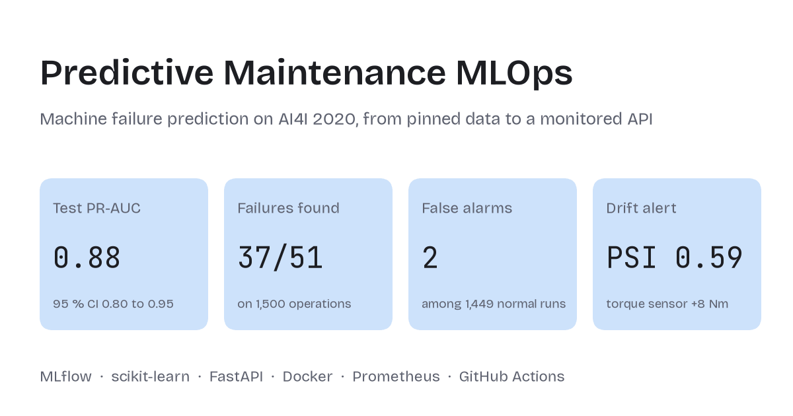
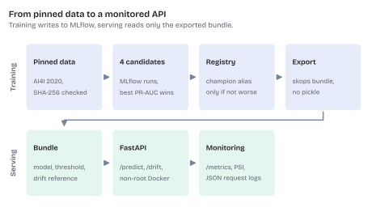
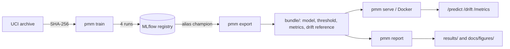
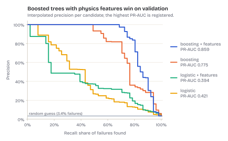
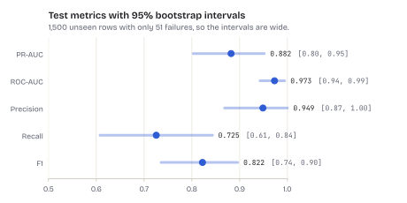
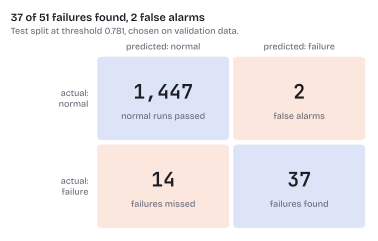
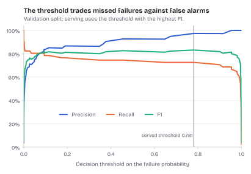
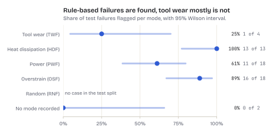
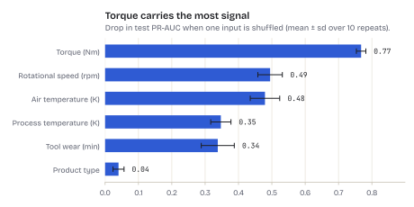
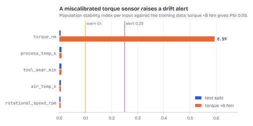

# Predictive maintenance MLOps

[](https://github.com/BenBotsch/PredictiveMaintenanceMLOps/actions/workflows/ci.yml)

[](LICENSE)
[](https://github.com/astral-sh/ruff)


<picture>
  <source media="(prefers-color-scheme: dark)" srcset="docs/figures/card-dark.png">
  
</picture>

Predicts machine failures in milling operations on the AI4I 2020 dataset and carries the model
through the whole lifecycle: a pinned dataset, tracked training runs, a model registry with a
promotion rule, an exported serving bundle, an HTTP API with Prometheus metrics and structured logs
in a container, a drift check on incoming readings and a reproducible report with every figure and
table below. The model is deliberately simple; the point is the path around it.

```text
pmm download   UCI archive, checked against a pinned SHA-256
pmm train      4 candidates as MLflow runs; best by validation PR-AUC is registered
               and gets the alias "champion" only if it is at least as good as the current one
pmm export     champion + threshold + drift reference -> bundle/ (skops, no pickle)
pmm report     evaluation of the bundle -> results/ (JSON, Markdown tables), docs/ (figures)
pmm serve      FastAPI on bundle/: /predict, /drift, /metadata, /health, /metrics
docker build   serving image without MLflow, matplotlib and training data
```

## Architecture

<picture>
  <source media="(prefers-color-scheme: dark)" srcset="docs/figures/pipeline-dark.svg">
  
</picture>

The two halves share exactly one artefact, the bundle. Training needs MLflow and the data; serving
needs neither, so the image stays small and a broken tracking server cannot take the API down.



## Results

Stratified split 70/15/15 with seed 0; the test split has 1,500 rows, 51 of them failures (3.4 %).
The threshold is the one with the best F1 on validation. The test split is scored once, for the
registered model only. All numbers below are produced by `pmm report` from the exported bundle and
are stored in [results/report.json](results/report.json) and
[results/tables.md](results/tables.md); the training run itself is in
[results/training.json](results/training.json).

### Model selection

<picture>
  <source media="(prefers-color-scheme: dark)" srcset="docs/figures/pr-curves-dark.svg">
  
</picture>

| Candidate | Val PR-AUC | Val F1 |
| --- | ---: | ---: |
| Logistic regression | 0.421 | 0.473 |
| Logistic regression + features | 0.394 | 0.436 |
| Gradient boosting | 0.775 | 0.758 |
| **Gradient boosting + features** | **0.859** | **0.832** |

The features are mechanical power (torque times angular speed), the gap between process and air
temperature, and torque times tool wear. They help the trees a lot and the linear model not at
all: the failures sit inside or outside bands of these quantities, which a single weighted sum
cannot express.

### Test metrics with uncertainty

<picture>
  <source media="(prefers-color-scheme: dark)" srcset="docs/figures/test-metrics-dark.svg">
  
</picture>

| Metric | Test | 95 % interval |
| --- | ---: | ---: |
| PR-AUC | 0.882 | 0.803–0.952 |
| ROC-AUC | 0.973 | 0.943–0.994 |
| Precision | 0.949 | 0.868–1.000 |
| Recall | 0.725 | 0.608–0.843 |
| F1 | 0.822 | 0.736–0.896 |

With 51 failures, one failure more or less moves recall by two points. The intervals come from
1,000 bootstrap resamples drawn within each class, so every resample keeps all 51 failures and the
PR-AUC stays defined. Recall is the least certain number: anything between about 61 % and 84 % is
compatible with this test split.

### Errors at the served threshold

<picture>
  <source media="(prefers-color-scheme: dark)" srcset="docs/figures/confusion-dark.svg">
  
</picture>

At threshold 0.781 the model finds 37 of 51 failures and raises 2 false alarms among 1,449 normal
operations. Missed failures (14) outnumber false alarms by seven to one, which is the right
direction to tune if a missed failure is cheap and an unnecessary stop is expensive, and the wrong
one otherwise.

<picture>
  <source media="(prefers-color-scheme: dark)" srcset="docs/figures/threshold-dark.svg">
  
</picture>

F1 is nearly flat between 0.1 and 0.95, so the choice of threshold is a business decision rather
than a statistical one: a lower threshold finds a few more failures and pays with clearly more false
alarms. The threshold is stored next to the model in the bundle, not inside it, so moving it
would not need a new model.

### Which failures are found

<picture>
  <source media="(prefers-color-scheme: dark)" srcset="docs/figures/failure-modes-dark.svg">
  
</picture>

| Failure mode | Detected | Recall |
| --- | ---: | ---: |
| Tool wear (TWF) | 1 of 4 | 25% |
| Heat dissipation (HDF) | 13 of 13 | 100% |
| Power (PWF) | 11 of 18 | 61% |
| Overstrain (OSF) | 16 of 18 | 89% |
| Random (RNF) | 0 of 0 | n/a |
| No mode recorded | 0 of 2 | 0% |

The mode columns are read only for this analysis; they never reach the model. Failures from a
clear physical rule (heat dissipation, overstrain) are found almost completely. Tool wear failures
happen at a random wear time between 200 and 240 minutes, so the inputs cannot tell when; the model
finds one of four. One
failure can have several modes, so the rows add up to more than 51. The test split contains no
random failure (RNF), and two failures have no mode recorded at all; neither is predictable from
the inputs.

### What the model uses

<picture>
  <source media="(prefers-color-scheme: dark)" srcset="docs/figures/importance-dark.svg">
  
</picture>

| Input | PR-AUC drop when shuffled |
| --- | ---: |
| `torque_nm` | 0.768 ± 0.014 |
| `rotational_speed_rpm` | 0.495 ± 0.037 |
| `air_temp_k` | 0.479 ± 0.044 |
| `process_temp_k` | 0.347 ± 0.030 |
| `tool_wear_min` | 0.338 ± 0.050 |
| `type` | 0.040 ± 0.017 |

Permutation importance on the raw inputs, so each shuffled column also breaks the features derived
from it. Torque enters both power and the product of wear and torque, which decides overstrain;
that is why it matters most. The
product type changes the overstrain limit only slightly and contributes almost nothing.

## What these numbers do and do not say

AI4I 2020 is synthetic. Its failures come from fixed rules on exactly the quantities the features
compute (power outside a band, a small temperature gap at low speed, wear times torque above a
limit), plus random failures that no input can predict. The gain from the features therefore shows
that the right physical quantities matter; it does not show how much they would help on a real
machine, where failure mechanisms are unknown, overlap and drift.

- The five failure-mode columns (TWF, HDF, PWF, OSF, RNF) are dropped before training, because they
  define the target. The report reads them only to break the test result down.
- 51 test failures are few. The intervals above are honest about that; differences of a few points
  between candidates or runs are within noise.
- The predicted probabilities are not calibrated: at 3.4 % prevalence almost every score is close
  to 0, so a reliability curve has nothing to show. Use the scores to rank and the threshold to
  decide, not as a probability of failure.
- Random and unlabelled failures set a ceiling on recall that no model on these inputs can pass.

The [model card](docs/model_card.md) sums up purpose, data, metrics and limits in one place.

## Drift

<picture>
  <source media="(prefers-color-scheme: dark)" srcset="docs/figures/drift-dark.svg">
  
</picture>

The bundle keeps the decile edges of every numeric feature in the training data. `/drift` and
`pmm drift <csv>` compare a batch of at least 500 readings against them with the population
stability index: below 0.1 is ok, from 0.1 a warning, from 0.25 an alert. On the test split every
feature stays below 0.01; adding 8 Nm to every torque reading, as a miscalibrated sensor would,
gives a PSI of 0.59 for torque and an alert, while the other features stay unchanged.

The minimum batch size comes from sampling noise. Without any drift, a batch of n readings has an
expected PSI of about 9 · (1/n + 1/N) against the ten bins of N training rows. For 100 readings
that is 0.091, almost the warning threshold, and random batches of 100 unseen rows warned for at
least one feature in 91% of 1,000 trials; batches of 500 never did.

The reference is a random sample of the training rows, so it fits batches that are random samples
too. Readings in time order are different: in AI4I, air and process temperature follow a random
walk, and five blocks of 1,000 consecutive rows in file order, one every 2,000 rows, each raised an
alert for them, although all their values lie inside the training range. Such inputs need longer
windows or a range check instead.

The check only sees the inputs. Whether the model still predicts well needs labels, i.e. failures
that actually happened, and a scheduled comparison against them; that is not part of this project.

## Observability

The API exposes Prometheus metrics at `/metrics` and writes one JSON line per request.

| Metric | Type | Meaning |
| --- | --- | --- |
| `pmm_requests_total` | counter | requests by method, route template and status |
| `pmm_request_duration_seconds` | histogram | latency by route |
| `pmm_readings_scored_total` | counter | readings scored by `/predict` |
| `pmm_failures_predicted_total` | counter | readings above the threshold |
| `pmm_drift_psi` | gauge | PSI per feature of the last `/drift` batch |
| `pmm_model_info` | info | name, version and MLflow run of the served model |

```json
{"event": "request", "request_id": "3f2c9a…", "method": "POST", "route": "/predict", "status": 200, "duration_ms": 11.8}
```

Routes are logged and labelled by their template, never by the raw path, so unknown URLs cannot
blow up the label set. A client's `X-Request-ID` is passed through if it is 1 to 64 characters of
`A-Z a-z 0-9 - _ .`, otherwise the API generates one; either way it comes back in the response
header. Readings and predictions are never logged.

Measured in-process with `TestClient` on the development machine (50 repeats):

| Batch | Median | p95 |
| ---: | ---: | ---: |
| 1 | 12.2 ms | 14.8 ms |
| 1,000 | 22.6 ms | 32.2 ms |

Scoring 1,000 readings takes only about twice as long as scoring one, so the fixed cost per
request dominates; clients should send batches.

## Run it

Needs [uv](https://docs.astral.sh/uv/) and, for the container, Docker.

```sh
uv sync
uv run pmm download
uv run pmm train          # MLflow tracking and registry in mlflow.db
uv run pmm export         # writes bundle/
uv run pmm report         # writes results/ and docs/figures/
uv run pmm serve          # http://127.0.0.1:8000/docs
uv run pytest --cov       # runs on invented data, no download needed
```

Inspect the runs with `uv run mlflow ui --backend-store-uri sqlite:///mlflow.db`. A second
`pmm train` registers a new version and keeps the champion unless the new one is at least as good.
`pmm report --no-figures` writes only the JSON and Markdown results.

```sh
docker build -t pmm .
docker run --rm -p 8000:8000 pmm
curl -s http://127.0.0.1:8000/predict -H 'Content-Type: application/json' \
  -d '{"readings": [{"type": "L", "air_temp_k": 302.0, "process_temp_k": 310.5,
       "rotational_speed_rpm": 1300, "torque_nm": 68.0, "tool_wear_min": 220}]}'
curl -s http://127.0.0.1:8000/metrics | grep pmm_
```

```json
{"model_version": "1", "threshold": 0.781,
 "predictions": [{"failure_probability": 0.999906, "failure": true}]}
```

For local checks before a commit: `uv run pre-commit install` runs Ruff, the formatter and mypy on
every commit.

## Design decisions

- **Serving without MLflow.** MLflow is in the `train` dependency group, the figure tools in `report`.
  The image installs only the main dependencies and reads the bundle: model, threshold, test
  metrics and drift reference.
- **skops instead of pickle.** Loading a bundle runs no code beyond an explicit list of trusted
  types (the feature function and the boosting trees).
- **Promotion by rule, not by hand.** A worse retraining is registered but does not move the
  alias, so serving never silently gets worse. A test retrains on noisy data to check that.
- **Strict input validation.** Unknown fields, impossible values and batches over 1,000 readings
  are rejected with 422.
- **Report from the bundle.** `pmm report` evaluates exactly what is served, not the training run,
  and reproduces the test metrics in the bundle to the last digit.
- **Figures as code.** Every image is rendered from the report data with
  [FigureKit](https://github.com/BenBotsch/FigureKit), the figure style of all my projects: a light
  and a dark theme as transparent SVG and PNG, with colours checked for colour-vision deficiencies.
  A new training run updates them with one command, and CI checks them with `figkit check`.

## Layout

```text
src/pmm/       data, model, train (MLflow), bundle, drift, api, report, figures, cli
tests/         unit tests and an end-to-end test on invented data
results/       training run, report summary and Markdown tables
docs/          model card, figures for the README and the web (see docs/figures/README.md)
Dockerfile     serving image, non-root
.github/       CI: lint, types, tests with coverage; then the full pipeline on the real data up
               to the report and requests against the running container; Dependabot
```

## Data and citation

AI4I 2020 Predictive Maintenance Dataset, UCI Machine Learning Repository, licensed CC BY 4.0
(<https://archive.ics.uci.edu/dataset/601/ai4i+2020+predictive+maintenance+dataset>). The data is
downloaded at run time and not part of this repository.

S. Matzka, "Explainable Artificial Intelligence for Predictive Maintenance Applications", Third
International Conference on Artificial Intelligence for Industries (AI4I), 2020.

## License

MIT, see [LICENSE](LICENSE).
