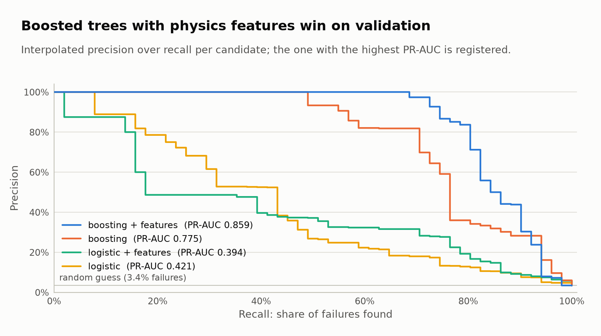

# Web images

Generated by `uv run pmm report` from [results/report.json](../../results/report.json); do not edit
by hand. Every figure exists in a light and a dark theme and in two widths, as WebP:

```text
<name>-<theme>-1600.webp   for large screens and high-density displays
<name>-<theme>-800.webp    for phones and narrow columns
card-<theme>.png           1200 x 630 social preview (Open Graph, LinkedIn)
```

The 800 px versions are rendered again from the vector figure, not scaled down from 1600 px, so
lines and text stay sharp: body text is about 13 px high there, the smallest labels about 12 px.
PNG fallbacks at 1600 px are in [../figures](../figures). Every WebP file is below 60 KB.

## Files and alt texts

| Name | Alt text |
| --- | --- |
| `card` | Predictive maintenance MLOps: test PR-AUC 0.88, 37 of 51 failures found with 2 false alarms, drift alert at PSI 0.59 for a shifted torque sensor. |
| `pipeline` | Training lane from pinned data through MLflow runs and registry to an exported bundle; serving lane where a FastAPI container loads only the bundle. |
| `test-metrics` | Five test metrics with 95 % bootstrap intervals: PR-AUC 0.882, ROC-AUC 0.973, precision 0.949, recall 0.725, F1 0.822. |
| `pr-curves` | Precision-recall curves of four candidates; gradient boosting with physical features is highest. |
| `confusion` | Confusion matrix on 1,500 test operations: 37 failures found, 14 missed, 2 false alarms, 1,447 correct negatives. |
| `threshold` | Precision, recall and F1 over the decision threshold; F1 is flat over a wide range, the served threshold 0.781 is marked. |
| `failure-modes` | Recall by failure mode: heat dissipation 100 %, overstrain 89 %, power 61 %, tool wear 25 %. |
| `importance` | Permutation importance: torque matters most, product type hardly at all. |
| `drift` | Population stability index per input: below 0.01 on test data, 0.59 for torque after an 8 Nm sensor offset. |

## HTML

The browser picks the theme from the visitor's system setting and the width from the layout:

```html
<picture>
  <source type="image/webp" media="(prefers-color-scheme: dark)"
          srcset="pr-curves-dark-800.webp 800w, pr-curves-dark-1600.webp 1600w"
          sizes="(max-width: 900px) 100vw, 800px">
  <source type="image/webp"
          srcset="pr-curves-light-800.webp 800w, pr-curves-light-1600.webp 1600w"
          sizes="(max-width: 900px) 100vw, 800px">
  
</picture>
```

Set `width` and `height` to the figure's real size so the page does not jump while loading. All
figures are 1600 px wide; the heights at that width are:

| Figure | Height |
| --- | ---: |
| `card` | 840 |
| `pipeline` | 832 |
| `test-metrics`, `failure-modes`, `importance` | 800 |
| `pr-curves`, `confusion`, `threshold` | 896 |
| `drift` | 864 |

Social preview, in the page `<head>`:

```html
<meta property="og:image" content="https://example.com/img/card-light.png">
<meta property="og:image:width" content="1200">
<meta property="og:image:height" content="630">
<meta property="og:image:alt" content="Predictive maintenance MLOps: test PR-AUC 0.88, 37 of 51 failures found with 2 false alarms.">
```
